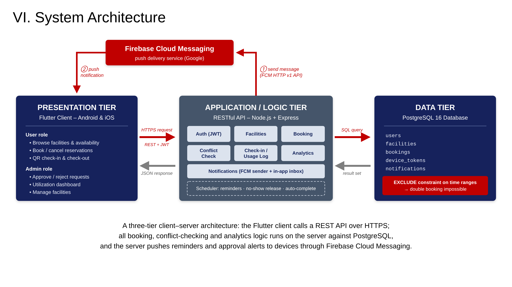
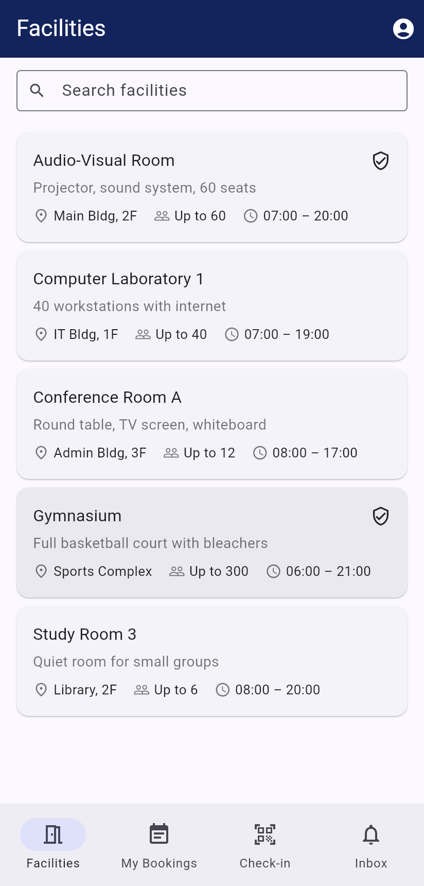
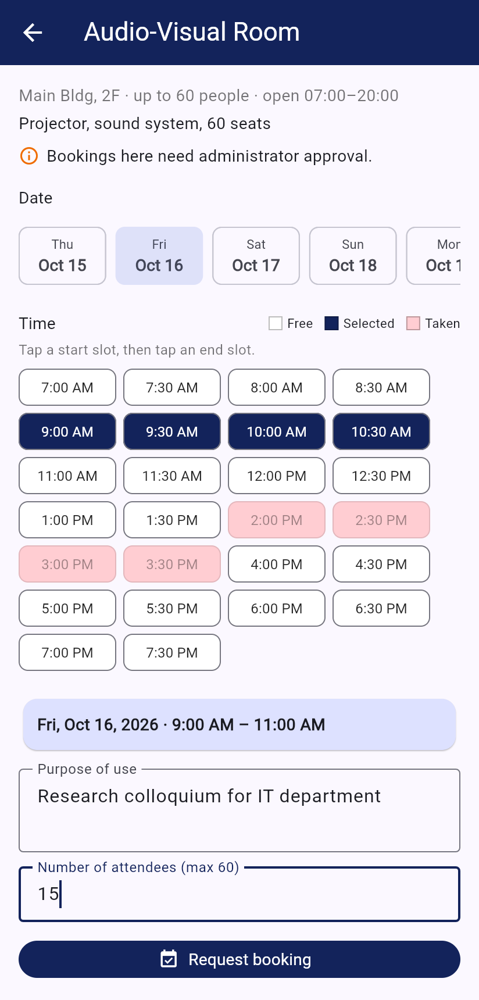
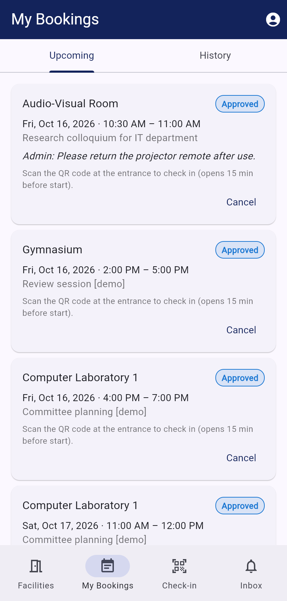
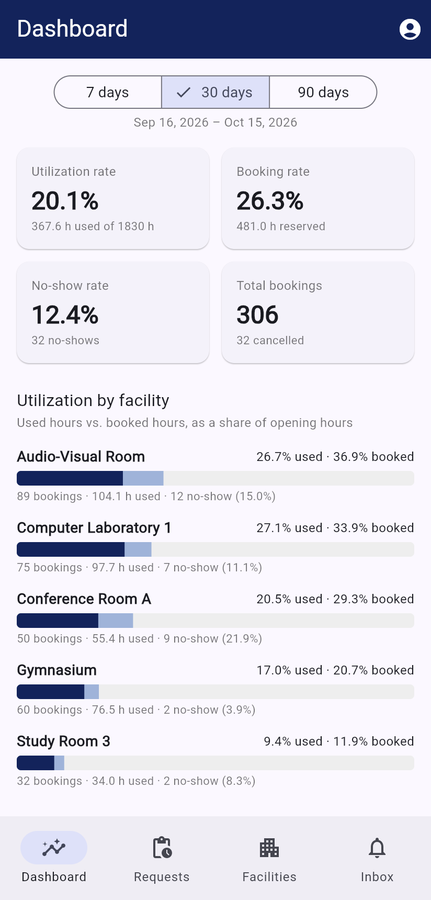
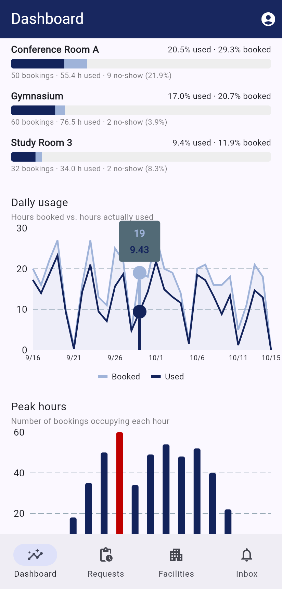

# Facility Booking and Utilization Monitoring

A mobile app (Flutter, Android & iOS) for reserving campus facilities and monitoring how they are actually used. It is backed by a REST API (Node.js + Express) and a PostgreSQL database, and uses Firebase Cloud Messaging for push notifications.



```
facility-booking/
├── backend/     Application / Logic tier — REST API, scheduler, analytics
│   ├── db/      schema.sql, migrate/seed script, demo-data generator
│   ├── src/     routes, middleware, services (FCM), jobs (scheduler)
│   └── test/    integration tests against a real PostgreSQL database
├── mobile/      Presentation tier — Flutter client (user + admin roles)
└── docs/        architecture diagram (SVG/PNG) and app screenshots
```

## Features

**Users**
- Browse facilities (location, capacity, opening hours) and search them
- See a day's free and taken 30-minute slots, then pick a start and an end slot to book
- Bookings are confirmed instantly, or go to an admin first when the facility requires approval
- **QR check-in** on arrival (scan the code posted at the door) and **check-out** on leaving
- Cancel upcoming bookings, view booking history, and get an in-app inbox plus push notifications

**Administrators**
- Approve or reject requests, with remarks the user sees
- Add, edit and deactivate facilities, and print each facility's check-in QR code (it can be regenerated if leaked)
- **Utilization dashboard** for 7, 30 or 90 days: utilization rate, booking rate and no-show rate, a per-facility breakdown, daily booked vs. used hours, and peak hours

**Automatic (server scheduler, every minute)**
- Sends a reminder 30 minutes before a booking starts
- Marks a booking **no-show** when nobody checks in within 15 minutes of the start, which frees the slot
- Auto-completes checked-in bookings at their end time
- Expires pending requests that nobody reviewed before the start time

### How double booking is prevented
The `bookings` table has a PostgreSQL **exclusion constraint**:

```sql
EXCLUDE USING gist (facility_id WITH =, tstzrange(starts_at, ends_at, '[)') WITH &&)
  WHERE (status IN ('pending','approved','checked_in'))
```

The database itself rejects any overlapping "live" booking for the same facility, even when two requests arrive at the same moment. There is a test that fires 8 simultaneous requests for one slot and checks that exactly one succeeds.

### Utilization metrics (over the selected date range)
| Metric | Formula |
|---|---|
| Available hours | facility opening hours × number of days |
| Booked hours | reserved time of approved, checked-in, completed and no-show bookings |
| Used hours | time from check-in to check-out (or to the scheduled end) |
| **Booking rate** | booked hours ÷ available hours |
| **Utilization rate** | used hours ÷ available hours |
| **No-show rate** | no-shows ÷ (no-shows + checked-in + completed) |

The gap between the booking rate and the utilization rate shows space that is reserved but not actually used.

## Running it

### 1. Database and API
Requirements: Node.js 20+ and PostgreSQL 14+.

```bash
createdb facility_booking
cd backend
cp .env.example .env          # edit DATABASE_URL / JWT_SECRET
npm install
npm run db:seed               # schema + 2 accounts + 5 sample facilities
npm run db:demo               # optional: ~2 months of realistic booking history
npm start                     # http://localhost:3000/api
```

Demo accounts (password `password123`):
- `admin@example.com` — administrator
- `user@example.com` — regular user
- `ana@example.com`, `mark@example.com`, … — extra users created by `db:demo`

### 2. Mobile app
Requirements: Flutter 3.41 or newer (Dart 3.11+).

```bash
cd mobile
flutter pub get
flutter run                                                     # Android emulator → host's localhost:3000
flutter run --dart-define=API_BASE_URL=http://localhost:3000/api  # iOS simulator
flutter run --dart-define=API_BASE_URL=http://192.168.1.10:3000/api  # physical phone on the same Wi-Fi
```

### 3. Push notifications (optional)
The app and API both work without Firebase; notifications then only appear in the in-app Inbox. To turn on push:
1. Create a Firebase project and add the Android and iOS apps (`edu.facilitybooking.facility_booking`).
2. In `mobile/`, run `flutterfire configure`, or add `google-services.json` and `GoogleService-Info.plist` by hand.
3. Download a service-account key (Firebase console → Project settings → Service accounts) and set `GOOGLE_APPLICATION_CREDENTIALS=/path/to/key.json` in `backend/.env`.

### Tests
```bash
cd backend && npm test   # needs PostgreSQL; uses database facility_booking_test (set TEST_DATABASE_URL to override)
cd mobile  && flutter test
```

## REST API

All endpoints are under `/api`. Every endpoint except register and login needs an `Authorization: Bearer <JWT>` header. Errors come back as `{ "error": "message", "details"?: [...] }`.

| Method | Endpoint | Who | Purpose |
|---|---|---|---|
| POST | `/auth/register` | public | Create an account and get a token |
| POST | `/auth/login` | public | Get a token |
| GET | `/auth/me` | any | Current user |
| POST / DELETE | `/auth/device-token` | any | Register or remove an FCM device token |
| GET | `/facilities` | any | Active facilities (`?all=true` for admins) |
| GET | `/facilities/:id/availability?date=YYYY-MM-DD` | any | Busy ranges for a day |
| POST / PUT / DELETE | `/facilities[/:id]` | admin | Create, update or deactivate |
| GET | `/facilities/:id/checkin-qr` | admin | QR payload to print |
| POST | `/facilities/:id/checkin-qr/rotate` | admin | Invalidate the old QR code |
| POST | `/bookings` | any | Create a booking (validates hours, capacity and overlaps) |
| GET | `/bookings/mine?scope=upcoming\|past` | any | Own bookings |
| GET | `/bookings?status=&facility_id=&from=&to=` | admin | All bookings |
| GET | `/bookings/:id` | owner/admin | One booking |
| POST | `/bookings/:id/cancel` | owner/admin | Cancel |
| POST | `/bookings/:id/approve` · `/reject` | admin | Decide a pending request (`{ remarks }`) |
| POST | `/bookings/check-in` | any | `{ qr_payload }` from the facility QR |
| POST | `/bookings/:id/check-in` | admin | Manual check-in fallback |
| POST | `/bookings/:id/check-out` | owner/admin | Finish using the facility |
| GET | `/notifications` · POST `/notifications/read-all` | any | In-app inbox |
| GET | `/analytics/summary?from=&to=&facility_id=` | admin | Utilization report |

### Booking lifecycle
```
                 ┌── reject ──► rejected
create ─► pending┤
   │             └── approve ─┐
   └── (no approval needed) ──┴► approved ── QR check-in ─► checked_in ── check-out / end ─► completed
                                    │  └── no check-in within 15 min ─► no_show
                                    └── cancel ─► cancelled
```

## Configuration (`backend/.env`)
| Variable | Default | Meaning |
|---|---|---|
| `APP_TIMEZONE` | `Asia/Manila` | Time zone of facility opening hours and reports |
| `CHECKIN_EARLY_MIN` / `CHECKIN_GRACE_MIN` | 15 / 15 | Check-in window around the start time |
| `REMINDER_MINUTES_BEFORE` | 30 | When the reminder push is sent |
| `MAX_BOOKING_HOURS` | 8 | Longest allowed booking |
| `MAX_ADVANCE_DAYS` | 60 | How far ahead users can book |

## Screenshots
| | | |
|---|---|---|
|  |  |  |
|  |  |  |
